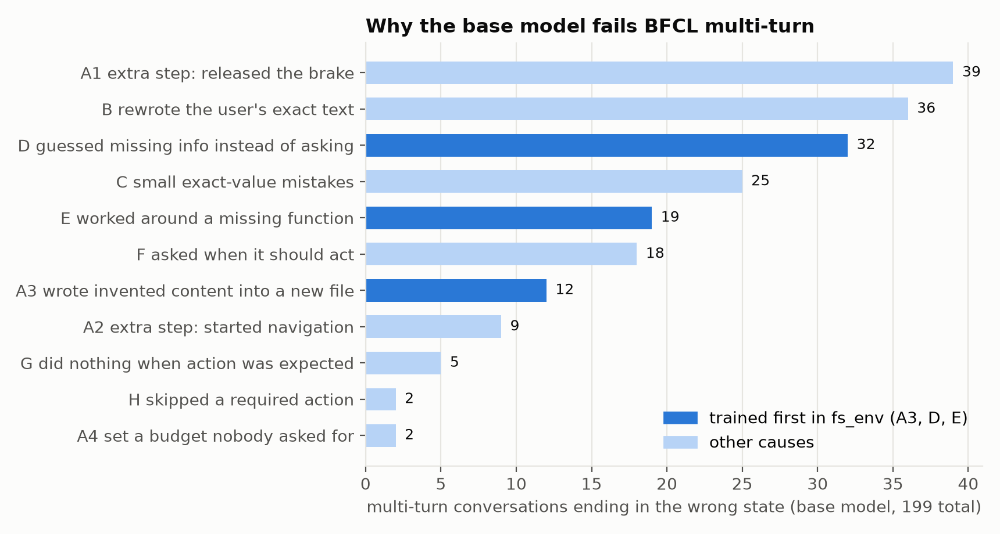
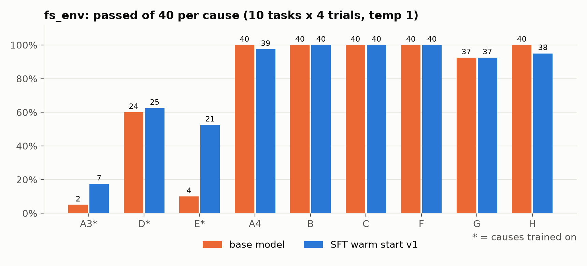
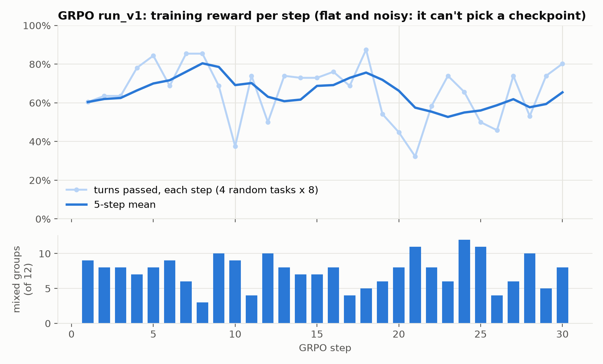
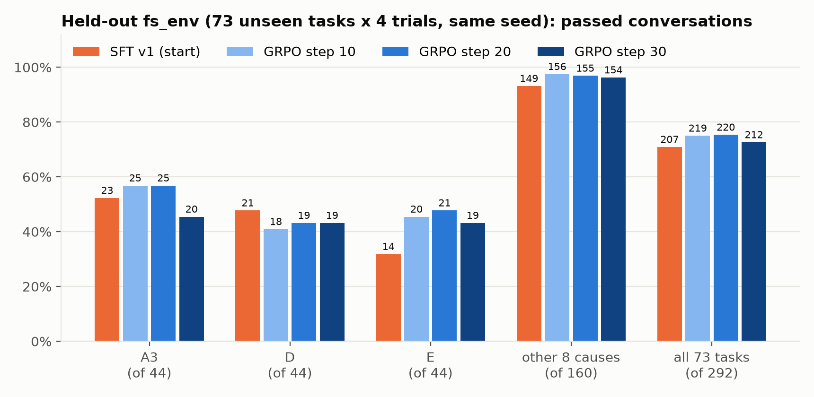
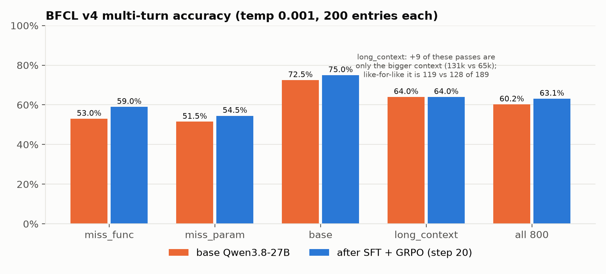
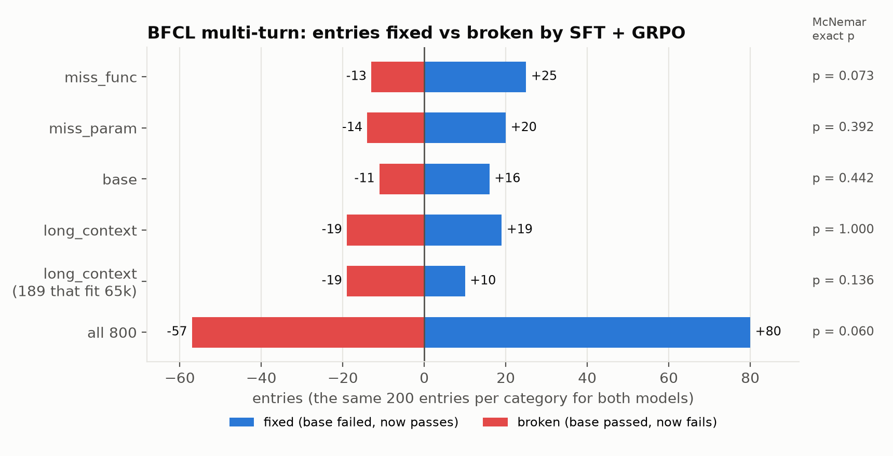
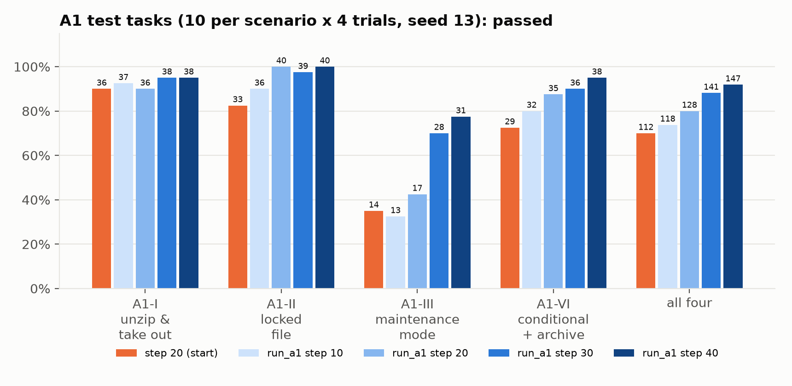
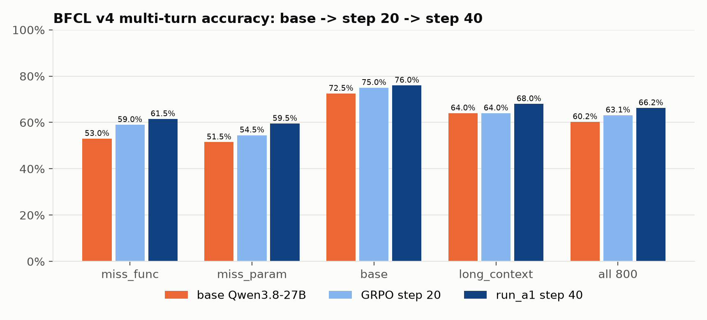
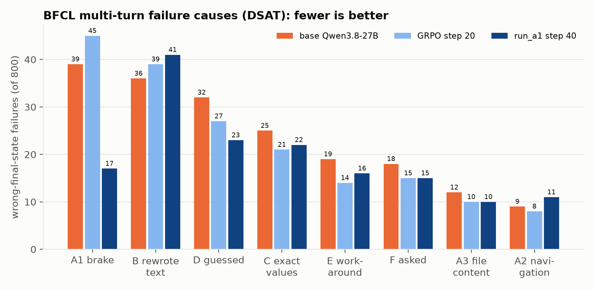

# Qwen3.8-27B on BFCL multi-turn: find why it fails, build an environment for those failures, train with SFT + GRPO

AI friendly

**TL;DR:** We ran the full BFCL v4 benchmark on `Qwen/Qwen3.8-27B` (thinking on) and read every multi-turn conversation
that ended in the wrong state. Three of the failure causes looked trainable: the model **writes invented content into
files it was only asked to create** (A3), **guesses missing information instead of asking** (D), and **works around a
missing function instead of saying it can't** (E). We built **fs_env**, a small in-memory file system with 14 tools and
380 tasks that reproduce these causes (plus regression checks for the others), gave the model a light **SFT warm start**,
then trained it with **GRPO** on the training split.

On fs_env's 73 **held-out** tasks the best checkpoint (GRPO step 20) passes **75.3%** vs **70.9%** for the SFT start
(p = 0.066). On **BFCL multi-turn**, which the model never trained on, it scores **63.1% vs 60.2%** for the base model,
led by **miss_func +6.0 points** (the BFCL category closest to cause E). **None of it is significant at p < 0.05**, and
part of the BFCL gain is an artifact (a bigger context window helped 9 long_context entries; like-for-like the overall
gain is about +1.8 points, p = 0.25), so read it as *suggestive transfer*, not a proven one. The training run also
**peaked mid-way**: step 30 was worse than steps 10 and 20 on held-out tasks.

**Then the brake (section 10).** The biggest failure cause, A1 (the model releases the car's brake after starting the
engine, an extra step nobody asked for), had *grown* after the first GRPO run (39 → 45). We added zip archives, locked files
and a maintenance mode to fs_env, so the model has to set up a precondition to do what is asked and then **leave it as it
is**, wrote 200 training and 60 test tasks around that, and continued GRPO from step 20 for 40 steps. On the A1 test tasks
step 40 passes **147/160 vs 112/160** (p < 0.001). On **BFCL multi-turn it scores 66.2% vs 60.2% for the base model
(p = 0.0001; like-for-like p = 0.0013) and 63.1% for step 20 (p = 0.014)**, and the brake failures fall from **39 to 17**:
the habit learned on files transferred to a car it never trained on. This is the first result here that is clearly significant.

Everything is in this repo: the environment, the training code, every eval (all conversations, with the model's
thinking), the notebooks and the scripts that made the figures. LoRA weights (~450 MB each) are not in git (see
[Repo contents](#repo-contents)).

## The benchmark

[BFCL v4](https://gorilla.cs.berkeley.edu/leaderboard.html) (Berkeley Function Calling Leaderboard) scores tool calling with
its own deterministic checkers, no LLM judge. Its **multi-turn** part has four categories of 200 conversations each: the
model works through several user turns against stateful simulated systems (file system, car, trading, travel, Twitter,
ticketing...), and an entry passes only if the system's state and the call results match the expected ones after every
turn.

| Category | What it tests |
|---|---|
| `multi_turn_base` | plain multi-turn tool use |
| `multi_turn_miss_func` | a function the turn needs is withheld: the model should say it can't (it gets the function in a later turn) |
| `multi_turn_miss_param` | the turn leaves out a needed value: the model should ask instead of guessing |
| `multi_turn_long_context` | the same tasks with large, noisy tool outputs |

## What we did

### 1. Baseline: the whole of BFCL v4, no fine-tuning

`Qwen/Qwen3.8-27B` in bf16, served by vLLM 0.30.0 (`--tool-call-parser qwen3_coder --reasoning-parser qwen3`), FC mode
(native tool calls), thinking on, temperature 0.001 (BFCL's default), 16,384 output tokens per model call, one A100 80GB.
Every category except `web_search` (needs a paid SerpAPI key) and `format_sensitivity` (prompt-mode models only): 20
categories, 4,906 entries, ~15 h, ~$28.

| Group | Accuracy |
|---|---|
| Non-live (single-turn, synthetic) | 85.8% |
| Live (single-turn, user-contributed) | 80.5% |
| **Multi-turn** | **60.3%** (base 72.5, miss_func 53.0, miss_param 51.5, long_context 64.0) |
| Memory (kv / vector / recursive summary) | 72.3% |

BFCL's own "Overall Acc" (56.9%) counts the skipped web search as zero. Setup, scripts and gotchas: `docs/BFCL_SETUP.md`;
notebooks `notebooks/bfcl_q38_27b_eval.ipynb` (plotly) and `..._matplotlib.ipynb`; data `results/bfcl_run.json` and
`results/pod/`. Every multi-turn conversation can be read in `renders/bfcl_multi_turn.html`.

### 2. Why it fails multi-turn: a DSAT without an LLM

Of 318 failed multi-turn entries, 199 (63%) end with the simulated system in the **wrong state**.
`analysis/dsat_multi_turn.py` lines up the model's state-changing calls with the expected ones turn by turn and finds the
first turn where they differ; `analysis/final_state_root_causes.py` labels each conversation with a root cause, named after
reading samples of every cluster. Full report with examples: `analysis/final_state_dsat.md`.



The biggest cause (A1, releasing the car's brake after starting the engine) is mostly a benchmark convention. We picked
**A3, D and E** to train first: they are clear behaviors, each is tied to one BFCL category (all 32 D failures are in
miss_param, all 19 E failures in miss_func), and they can be checked without an LLM. The other causes became **regression
checks**: training must not make the model over-ask (F) or under-act (G).

### 3. fs_env: an environment built from those failures

`fs_env/` is a small in-memory file system (`filesystem.py`) with **14 tools** (`tools.py`: `current_dir`, `list_dir`, `change_dir`,
`make_dir`, `create_file`, `write_file`, `read_file`, `delete_file`, `delete_dir`, `move`, `copy`, `find_files`,
`search_text`, `count`) and **380 tasks** (`tasks/*.json`): 100 each for A3, D and E
(one hand-written original, 9 more in `make_tasks.py`, 90 from the pattern families in `task_families.py`), 10 for each
other cause. Each task is a short multi-turn conversation in which every turn says what the model should do:

- **act**: change the files (passes if the file tree equals the target),
- **answer**: read only, and the reply must contain the answer,
- **ask**: information is missing: ask and change nothing,
- **refuse**: the tool it needs is withheld for that turn: say so and change nothing.

`checker.py` compares the tree with each turn's target (exact tree; per-file exact, `contains` or `regex` content) and
applies the turn's reply check, deterministically. Every load gives a task a random user name, **random folder names**
(nouns from `folder_words.txt`) and 2–5 random background files, so the model can't memorize paths.
`python -m fs_env.validate` replays every task's gold calls (380/380 valid), every task's `trap_example` (the observed
failure) must fail, and `python -m fs_env.test_fs_env` has 16 self-tests. `fs_env/split.json` splits the tasks into
**307 train / 73 held-out** (the held-out set includes every task that already had a "before" number, the 11 originals,
and 5 of every other cause as a regression check). There is a playground to try the tools and tasks by hand:
`python -m fs_env.playground.server` → http://localhost:8765.

### 4. The base model on fs_env

At temperature 1 (4 trials per task), the base model fails exactly where BFCL said it would: **A3 2/40, D 24/40, E 4/40**
on the first 10 tasks of each cause, while the other causes pass 37–40 of 40 (orange bars below). Notebook:
`notebooks/fs_env_q38_27b_eval.ipynb` (Parts 1–2); conversations: `renders/fs_env_*.html`.

This is a problem for GRPO: it learns from differences *within* a group of attempts at the same task. If all 8 attempts
fail the same way (E at 4/40), there is nothing to learn from.

### 5. SFT warm start: make the right behavior appear sometimes

`fs_env/sft_train.py` (QLoRA 4-bit, LoRA r=16 / alpha 32 on all linear layers, 1 epoch, lr 5e-5) on `train_v1` (688 one-turn examples, train
split only): one-step E refusals (tool missing: say so and ask for it), "the tool is back: use it right away" turns, and
conversations the base model already gets right as a counterweight. Each example is rendered with *that turn's* tool list,
and the loss covers only that turn's assistant messages (thinking, tool calls, reply). 86 steps, 54 min on an A100, peak
45 GB. Over-reaction probes (`fs_env/sft_probes.py`) check that the model doesn't start refusing or asking where it should
act. Notebook: `notebooks/sft_q38_27b_train.ipynb`.



E went from 4/40 to 21/40 and A3 from 2/40 to 7/40, enough signal for GRPO; nothing else moved by more than 2.

**A bug worth knowing about:** the first SFT eval looked like the SFT did nothing. vLLM had loaded the LoRA and applied
it to no layer: training loads Qwen3.8 as a text-only `AutoModelForCausalLM` (tensor names `...model.layers.*`), while
vLLM serves the vision-language class and expects `...model.language_model.layers.*`. It doesn't warn. That run is kept
in `results/fs_env/fs-results/invalid/` with a README; `fs_env/adapter_fix.py` renames the tensors, and every adapter
since then is checked by asking the base model and the LoRA the same question at temperature 0 (the answers must differ).

### 6. GRPO

`fs_env/grpo_train.py`, one H200 (141 GB) shared by vLLM (rollouts, bf16) and the QLoRA trainer:

- **Each step:** 4 **train** tasks (balanced: one each of A3, D and E, then random), each a fresh instance (new user name,
  folder names, clutter); a **group of 8** conversations per task with the current LoRA (temperature 1, thinking on, up to
  10 model calls per turn).
- **Reward per turn:** 1 if the turn passes the checker, else 0. **Advantage** within the group for the same task and
  turn: `(r − mean) / (std + 1e-4)`. Groups where all 8 got the same result carry no signal and are dropped; a task that
  comes out flat twice leaves the pool.
- **Update:** one on-policy policy-gradient step on the LoRA (`loss = −A × mean log-prob of that turn's assistant tokens`,
  masked like SFT), AdamW lr 5e-6, grad clip 1.0, no KL term. Then the adapter is saved, renamed for vLLM, and hot-loaded
  (`/v1/load_lora_adapter`).
- **Memory:** a 1-step dry run with both processes resident peaked at 137 of 140 GB with 4 recovered out-of-memory retries,
  so the real run puts vLLM to sleep during each update (`/sleep`, weights to CPU RAM), at ~30–60 s per step.

30 steps, A3/D/E, ~6.9 min per step, 3.4 h, ~$13. The over-reaction probes stayed at a 100% act rate the whole time.
Notebook: `notebooks/grpo_q38.ipynb`; every rollout of every step: `results/fs_env/grpo/run_v1/rollouts/`.



The training reward is flat and noisy. Each step draws only 4 random tasks, so a step's reward mostly says which tasks came
up. **It can't pick a checkpoint**; only held-out conversations can.

### 7. Held-out eval: which checkpoint?

The 73 held-out tasks × 4 trials, temperature 1, the **same seed** for every model (same user names, folder names and
clutter), for the SFT start and the kept GRPO checkpoints (every 5th step was kept; the pod's 30 GB disk could not hold
all 30).



| | passed (of 292) | vs SFT: fixed / broken | McNemar p |
|---|---|---|---|
| SFT v1 (start) | 207 (70.9%) | | |
| GRPO step 10 | 219 (75.0%) | 28 / 16 | 0.096 |
| **GRPO step 20** | **220 (75.3%)** | **28 / 15** | **0.066** |
| GRPO step 30 | 212 (72.6%) | 26 / 21 | 0.56 |

The run **peaked mid-way**: step 30 lost most of the gain, mainly on A3 (25 → 20 of 44 between steps 20 and 30). E
improved at every checkpoint (14 → 20/21/19 of 44); D didn't improve (21 → 18/19/19). The other 8 causes didn't regress
(149 → 154–156 of 160).

**Choosing the BFCL model:** the rule was fixed before seeing these numbers: highest overall; if within ±3, the higher
A3 + D + E total; if still tied, step 30. Step 20 (220, A3+D+E 65) beat step 10 (219, 63). Picking the best of three on
the same data flatters the winner a little, so step 20's held-out p-value is optimistic; BFCL is the independent test.

### 8. Does it transfer to BFCL?

GRPO step 20 on BFCL's four multi-turn categories, with the **same settings as the base-model baseline** (temperature
0.001, thinking on, 16,384 tokens per call, same BFCL commit `6ea5797`). One difference: the context limit was 131k
instead of 65k, because the baseline lost 11 long_context entries to it. 800 entries, 71 min on the H200.
Notebook: `notebooks/bfcl_eval_after_grpo_q38_27b.ipynb`.





| Category | base | GRPO step 20 | change | fixed / broken | McNemar p |
|---|---|---|---|---|---|
| **miss_func** | 53.0% | **59.0%** | **+6.0** | 25 / 13 | **0.073** |
| miss_param | 51.5% | 54.5% | +3.0 | 20 / 14 | 0.39 |
| base | 72.5% | 75.0% | +2.5 | 16 / 11 | 0.44 |
| long_context | 64.0% | 64.0% | 0.0 | 19 / 19 | 1.00 |
| long_context, the 189 that fit 65k | 67.7% | 63.0% | −4.8 | 10 / 19 | 0.14 |
| **all 800** | 60.2% | **63.1%** | **+2.9** | 80 / 57 | **0.060** |
| all, like-for-like (789) | 61.1% | 62.9% | +1.8 | 71 / 57 | 0.25 |

How to read it:

- **The gain lands where we aimed.** miss_func (cause E: say you can't instead of working around a missing function) has
  the biggest gain and the most lopsided fixed/broken split, matching fs_env, where E improved the most. miss_param
  (cause D) and base go the right way but are within noise.
- **long_context is not really flat.** 9 of the baseline's 11 context-limit failures pass now only because of the
  bigger window. On the 189 entries both runs could fit, GRPO is 9 entries *worse* (p = 0.14). The training
  conversations are short; long noisy tool outputs may be where the update hurt.
- **Which failures changed (DSAT on the new run):** the trained causes fell cleanly (E: 7 of 19 fixed, 1 new; D: 7 of
  32 fixed, 2 new), the brake (A1) churned (12 fixed, 17 new, mostly long_context), and rewriting the user's text (B)
  was untouched. Tables: `analysis/final_state_dsat.md`, last section;
  every conversation per cause: `renders/bfcl_dsat_base_vs_grpo20.html`.
- **Nothing is significant at p < 0.05.** The test is McNemar's exact test on paired entries (the same 200 entries per
  category for both models; only the entries where they disagree count).

### 9. What we take from it

- A DSAT → environment → GRPO loop can move a 27B model on the behaviors it targets, and the effect showed up on a benchmark
  it never trained on. The size of that effect isn't established yet: every comparison here is p ≈ 0.06–0.07 at best.
- The training reward was useless for choosing a checkpoint, and training longer made the model worse. Held-out
  evaluation of several checkpoints was worth its cost (~25 min, ~$2).
- Watch long contexts. Training only on short conversations may cost there.

### 10. A second GRPO run: teaching it to leave things as they are (A1, "the brake")

**Why A1.** It is BFCL's biggest failure cause (39 base-model failures) and the first run made it *worse* (45). In the
conversations the pattern is always the same: the user asks for one thing ("start the engine"); the environment refuses
until a precondition is met ("Brake pedal needs to be pressed"); the model sets it up, does the task, and then **undoes the
precondition** (releases the brake) "like a real driver", which nobody asked for. The DSAT viewer shows all of them:
`renders/bfcl_dsat_base_vs_grpo20.html`, tab A1.

**fs_env versions of the brake.** New tools `zip`, `unzip`, `lock`, `unlock` and a maintenance mode (`fs_env/filesystem.py`),
all kept inside the plain file tree so the checker sees every undo:

| | Scenario | The precondition (an error mid-turn) | The tempting undo (wrong) |
|---|---|---|---|
| A1-I | unzip & take out | "photos.zip is a zip archive: unzip it first" | re-zipping, deleting the extracted folder |
| A1-II | locked file | "notes.txt is locked: unlock it first" | locking it again |
| A1-III | maintenance mode | "server/ is protected: set 'maintenance: on' first" | switching maintenance back off |
| A1-IV | draft file | (a draft the user asked for) | deleting the draft after the final version |
| A1-V | unzip withheld | turn 1 has no unzip: say you can't | working around it, then undoing the extraction |
| A1-VI | conditional + archive | "if check.txt says ready, copy X from the archive, else Y" | deleting the extracted folder |

A later turn always relies on the precondition staying in place, so leaving it is the correct behavior, not just a
benchmark convention. **Test set:** `fs_env/task_sets/a1_brake.json`, 10 tasks per scenario (`make_a1_tasks.py`).
**Training set:** `fs_env/task_sets/a1_brake_train.json`, 50 tasks each for A1-I, A1-II, A1-III and A1-VI, 5 patterns x
10 themes (`make_a1_train_tasks.py`); no archive, theme or system folder is shared with the test set. Targets are computed
by replaying the gold calls, and every task's trap is verified to fail.

**Where step 20 stood** (A100, 4 trials, temperature 1, seed 13): A1-I 36/40, A1-II 33/40, **A1-III 14/40**, A1-IV 40/40,
A1-VI 29/40. On A1-III the model said it outright: *"I temporarily set maintenance: on to make the edit, then restored it
to maintenance: off to leave everything else as it was."* Conversations: `renders/a1_brake_grpo20.html`.

Two honest corrections along the way:
- **A1-V had a loophole.** Our archive format was readable text, so the model copied an archive to a name without `.zip`
  and read it (38 of 40 conversations). Fixed (a file is an archive by its content, not only its name); the leaky results
  are kept in `results/fs_env/a1_brake/grpo-s20/invalid/` with a README. A1-V wasn't used for training.
- **20 of the 200 training tasks had ambiguous wording** ("put X from the archive into Y" expected a copy; "take X out"
  expected a move). The run trained on them (~5% of rollouts penalized a reasonable move); fixed afterwards, the exact
  file the run used is `results/fs_env/grpo/run_a1/a1_brake_train_as_trained.json`. The test set was never affected.

**Training (run_a1).** From GRPO step 20, 40 steps; each step one task of each of A1-I, A1-II, A1-III, A1-VI plus **one
A3/D/E replay task** (so the first run's gains aren't forgotten), group 8, lr 5e-6, temperature 1, vLLM asleep during
updates. One H200 NVL, 7.9 min per step, 4 h. Checkpoints kept every 10 steps (`pod/prune_ckpt.sh`). New trainer options:
`--task-set`, `--replay-causes`, `--replay-per-step` (`fs_env/grpo_train.py`). Notebook: `notebooks/grpo_q38.ipynb`
(`RUN = "run_a1"`; section 6 compares both runs).

**On the A1 test tasks** (same 40 tasks of the four trained scenarios, same seed, paired with step 20):



| | step 20 | s10 | s20 | s30 | **s40** | s40 vs step 20 |
|---|---|---|---|---|---|---|
| A1-I unzip | 36/40 | 37 | 36 | 38 | **38** | p = 0.69 |
| A1-II locked | 33/40 | 36 | 40 | 39 | **40** | p = 0.016 |
| **A1-III maintenance** | **14/40** | 13 | 17 | 28 | **31** | **p = 0.001** |
| A1-VI conditional | 29/40 | 32 | 35 | 36 | **38** | p = 0.012 |
| **all four** | **112/160** | 118 | 128 | 141 | **147** | **p < 0.001** |

Unlike the first run, this one kept improving to its last checkpoint; pass^4 (all 4 trials right) went from 35% to 72.5%.
Notebook: `notebooks/a1_brake_eval.ipynb` (section 5); every conversation: `renders/a1_brake_run_a1_checkpoints.html`.

**On BFCL multi-turn** (step 40; same settings as before):



| Category | base | step 20 | **step 40** | step 40 vs base | step 40 vs step 20 |
|---|---|---|---|---|---|
| miss_func | 53.0% | 59.0% | **61.5%** | 33 / 16, p = 0.021 | p = 0.47 |
| miss_param | 51.5% | 54.5% | **59.5%** | 27 / 11, p = 0.014 | p = 0.076 |
| base | 72.5% | 75.0% | **76.0%** | p = 0.25 | p = 0.79 |
| long_context | 64.0% | 64.0% | **68.0%** | p = 0.24 | p = 0.17 |
| **all 800** | 60.2% | 63.1% | **66.2%** | **99 / 51, p = 0.0001** | **61 / 36, p = 0.014** |
| like-for-like (789) | | | | **p = 0.0013** | **p = 0.013** |



**The brake transferred.** A1 failures fall from 39 (45 at step 20) to **17**: 25 fixed, 9 new, and in long_context from 12
(17) to 6. The model learned "leave the precondition as it is" on archives, locks and a maintenance flag, and applies it to a
car it never saw in training. D keeps improving (32 → 23); long_context recovered from the first run's dip. **B (rewriting
the user's exact text) did not move (36 → 41)**: nothing has trained it yet. Every conversation:
`renders/bfcl_multi_turn_a1s40.html`; the failure causes, base vs step 40, side by side: `renders/bfcl_dsat_base_vs_a1s40.html`;
labels: `analysis/a1s40/`.

**What it means.** Building a small environment around one failure *mechanism* (set up a precondition, then leave it) beat
training on more generic file tasks: the first clearly significant BFCL gain here (p = 0.0001 vs the base model) and a 56%
drop in the targeted failure. The usual caveats still hold: one run, one seed per eval, and BFCL at temperature 0.001.

## Time and cost

All GPU time, grouped by GPU. Rows are parts; **bold rows are totals**.

| GPU | Part | Hours | Cost |
|---|---|---|---|
| A100 80GB ($1.80/h) | BFCL v4 baseline, 20 categories (whole pod session) | 15.0 | $28 |
| | fs_env base-model runs (Parts 1–2 + refresh) ¹ | 2.1 | $4 |
| | SFT warm start: training 54 min + eval 31 min ¹ | 1.4 | $3 |
| | **A100 total** | **18.5** | **$35** |
| H200 NVL ($3.79/h) | setup + dry run | 0.7 | $3 |
| | GRPO run_v1, 30 steps | 3.4 | $13 |
| | held-out evals: SFT + step 30, then steps 10 + 20 | 1.0 | $4 |
| | BFCL multi-turn on GRPO step 20 (incl. BFCL install) | 1.2 | $4 |
| | waiting between steps | 0.6 | $2 |
| | **H200 total** ² | **6.9** | **$26** |
| A100 80GB (~$1.80/h ³) | A1 test tasks on step 20 (+ the A1-V re-run attempts) | 1.4 | $3 |
| H200 NVL ($3.79/h) | run_a1: setup | 0.2 | $1 |
| | run_a1: GRPO, 40 steps | 4.0 | $15 |
| | run_a1: checkpoint tests (4 checkpoints at once) | 0.4 | $2 |
| | run_a1: BFCL install + multi-turn on step 40 | 1.4 | $5 |
| | **run_a1 total** ⁴ | **6.0** | **$23** |
| **All** | **Grand total** | **32.8** | **≈ $87** |

¹ Run time only: these pods' setup time wasn't logged, so the real cost is a little higher.
² From pod start (01:26) to the last download (08:20). The pod billed until it was terminated, so any time after 08:20
comes on top.
³ That pod's hourly rate wasn't recorded; the A100 rate of the earlier pods is assumed.
⁴ From pod setup (07:22 UTC) to the end of BFCL (13:25 UTC); time until the pod was terminated comes on top.

## Repo contents

```
README.md
fs_env/            the environment and all training code (run from the repo root: python -m fs_env.<module>)
  filesystem.py, tools.py, checker.py      in-memory file system, 14 tools (withheld tools for refuse turns), checker
  tasks.py, tasks/*.json, folder_words.txt 380 tasks; random user/folder names and clutter per load
  make_tasks.py, task_families.py          task generation; validate.py, test_fs_env.py: checks
  split.json, split.py                     307 train / 73 held-out
  run.py                                   runs tasks against a vLLM server (OpenAI API), one JSONL line per conversation
  sft_e_refusals.py, sft_export.py         SFT data; sft_train.py: QLoRA trainer; sft_probes.py: over-reaction probes
  grpo_train.py                            GRPO (rollouts in vLLM, turn rewards, group advantages, QLoRA update, hot swap)
  adapter_fix.py                           renames LoRA tensors so vLLM applies them (required, see section 5)
  task_sets/a1_brake.json, a1_brake_train.json    the A1 "brake" test (60) and training (200) tasks; make_a1_tasks.py,
                                           make_a1_train_tasks.py build them (section 10)
  RUN_ON_POD.md, playground/               pod runbook; a local page to try tools and tasks by hand
analysis/          the DSAT: dsat_multi_turn.py, final_state_root_causes.py, final_state_dsat.md (+ JSON labels);
                   grpo20/ + compare_dsat.py: the same DSAT on GRPO step 20 and the entry-by-entry comparison
                   a1s40/: the same DSAT on GRPO run_a1 step 40
pod/               pod-side scripts: setup, vLLM serving (BFCL, GRPO on A100/H200, LoRA for BFCL), BFCL runs
                   (run.sh full, run_multiturn.sh, partial_score.sh "passed so far"), BFCL handler (qwen38_vllm.py,
                   install_handler.py), GRPO helpers (setup_grpo.sh, after_grpo_eval.sh, eval_ckpts.sh, prune_ckpt.sh)
code/              make_figures.py (every figure in figures/); notebook builders (build_*.py); live JSON updaters
                   (*_update.py, *updater.sh); conversation viewers (build_mt_viewer.py, build_fs_viewer.py).
                   The builders and updaters ran from the project root: move them there to rerun them.
notebooks/         bfcl_q38_27b_eval(.._matplotlib).ipynb  section 1: BFCL v4 baseline
                   fs_env_q38_27b_eval.ipynb               sections 4-5: fs_env baselines, task fixes, SFT eval
                   sft_q38_27b_train.ipynb                 section 5: SFT training, probes
                   grpo_q38.ipynb                          sections 6-7: GRPO training, held-out checkpoint eval
                   bfcl_eval_after_grpo_q38_27b.ipynb      section 8: BFCL multi-turn after GRPO
                   a1_brake_eval.ipynb                     section 10: A1 test tasks, step 20 vs run_a1 checkpoints
                   (they read only JSON from results/; open them from notebooks/ or the repo root)
results/
  bfcl_run.json, pod/bfcl-results/          BFCL baseline: every result (with the full conversation and thinking) and score
  pod/run_logs/                             baseline pod logs and scripts as run
  fs_env/fs-results/                        fs_env runs (base, task-fix rerun, SFT), one line per conversation; invalid/
  fs_env/sft/                               SFT data (train_v1.jsonl + sources), run_v1 logs and probes
  fs_env/grpo/run_v1/                       GRPO: grpo_log.jsonl, probes.jsonl, status.json, rollouts/step_*.jsonl
    eval/                                   held-out evals: sft-v1, grpo-s10, grpo-s20, grpo-final (step 30), full conversations
    bfcl/                                   BFCL multi-turn on step 20: result/ (all 800 conversations), score/, partial/
    pod_logs/                               every pod log and script of the GRPO + eval session
  fs_env/grpo/dry/                          the 1-step dry run
  fs_env/a1_brake/                          A1 test tasks: grpo-s20/ (step 20, + invalid/ A1-V loophole run), run_a1-s10..s40/,
                                            run_a1_pod/ (logs); every conversation with the model's thinking
  fs_env/grpo/run_a1/                       run_a1: grpo_log.jsonl, probes, rollouts/, bfcl/ (BFCL on step 40), pod_logs/,
                                            a1_brake_train_as_trained.json (the training tasks exactly as used)
renders/           offline HTML viewers: bfcl_multi_turn_a1s40.html, bfcl_dsat_base_vs_a1s40.html (BFCL on run_a1 step 40);
                   a1_brake_grpo20.html, a1_brake_run_a1_checkpoints.html (A1 test conversations); bfcl_dsat_base_vs_grpo20.html (failure causes A1-H, base vs GRPO step 20 side by side:
                   fixed / same / new per conversation, first wrong turn, both full conversations);
                   bfcl_multi_turn.html (every baseline multi-turn conversation, grouped by failure
                   type), fs_env_*.html (every fs_env conversation per run)
figures/           the README figures (python code/make_figures.py)
docs/              BFCL_SETUP.md (baseline setup and gotchas), GRPO_HANDOFF.md (the brief the GRPO run started from)
```

**Not in git:** the LoRA weights (SFT v1, GRPO run_v1 steps 5-30, GRPO run_a1 steps 10/20/30/40; ~450 MB each, md5s in the training logs).

## Setup notes (for anyone reproducing this)

- **vLLM ignores a LoRA trained on the text-only class** without a warning (section 5). Run `fs_env/adapter_fix.py` and
  check that the base model and the LoRA answer differently at temperature 0.
- **Driver 570 pods** need the `vllm 0.30.0+cu129` wheel (the default wheel's torch cu130 fails with "driver too old"), and
  the training venv needs torch cu129 too.
- **FP8 doesn't work on A100** for this hybrid model (torch.compile and cutlass errors). On an H200, bf16 vLLM + the QLoRA
  trainer fit only with vLLM asleep during updates.
- **The hybrid model needs `--max-num-seqs ≤ 32`** (Mamba cache) and `VLLM_USE_FLASHINFER_SAMPLER=0`.
- **BFCL multi-turn at 32 threads overflowed the KV cache on an A100** (98% used); the H200 had room for 32.
  long_context needs `--max-model-len 131072` (65k loses 11 entries).
- **BFCL's summary CSVs shift columns** when the model's display name contains commas (`pod/install_handler.py` now
  registers names without commas). `bfcl evaluate --partial-eval` scores a category before it's finished.
- **RunPod:** `/dev/shm` is `noexec` (venvs must live on the container disk), and a 30 GB container disk fills up with
  venvs + per-step adapters (point uv's `TMPDIR`/`UV_CACHE_DIR` at `/dev/shm`, keep every 5th checkpoint). The SSH proxy
  (`ssh.runpod.io`) has no scp: `pod/rp.sh`.
- BFCL's streamed `latency` field is time to the first chunk, not the call's duration: use output tokens to estimate run
  time.

## Open questions

- **B, rewriting the user's exact text, is now the biggest cause (41)** and nothing trains it. The same recipe should fit:
  tasks where the user gives exact text to pass on, with a checker that wants it verbatim.
- Does run_a1 still help when trained longer? It was still improving at step 40.

- Is the transfer real? Repeated BFCL multi-turn runs at temperature > 0 for both models would add paired samples; the
  same effect size would then reach significance or not.
- Why did training past step 20 hurt A3? A KL term to the SFT start, or more tasks per step (less noisy updates), might
  keep the gain.
- Would training on long conversations (long tool outputs, many turns) prevent the long_context loss?
- D (asking for missing information) didn't improve on fs_env. Is the reward for "ask" turns too easy to satisfy by
  accident, or does the model need an SFT warm start for D too?
- The other causes (A1 brake, B rewriting the user's text, C exact values) are bigger than A3/D/E in BFCL. B and C fit the
  same environment idea.
